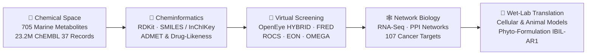

&lt;div align=&quot;center&quot;&gt;

&lt;!-- Animated Typing Header Banner --&gt;
&lt;a href=&quot;https://github.com/Ritwik-05&quot;&gt;
  &lt;img src=&quot;https://readme-typing-svg.demolab.com?font=Fira+Code&amp;weight=600&amp;size=24&amp;duration=3500&amp;pause=1000&amp;color=0EA5E9&amp;center=true&amp;vCenter=true&amp;multiline=true&amp;repeat=true&amp;width=850&amp;height=85&amp;lines=Ritwik+Patra%2C+Ph.D.;Computational+%26+Cheminformatics+Scientist;Marine+Natural+Products+%C2%B7+Virtual+Screening+%C2%B7+Multi-Omics&quot; alt=&quot;Ritwik Patra Typing SVG&quot; /&gt;
&lt;/a&gt;

### **Ritwik Patra, Ph.D.** — *Cheminformatics, Computational Drug Discovery, Network Pharmacology & Cancer Biology*

**Project Scientist-I** · Deep Ocean Mission · [**BRIC-Institute of Life Sciences (BRIC-ILS)**](https://www.ils.res.in/), Bhubaneswar, India

[](https://scholar.google.com/citations?user=DUs5jZ8AAAAJ&hl=en)
[](https://orcid.org/0000-0003-1450-1589)
[](https://www.researchgate.net/profile/Ritwik-Patra)
[](https://github.com/Ritwik-05)
[](mailto:ritwikpatra8@gmail.com)

&lt;/div&gt;

<br/>

## 🧬 Research Focus & Scientific Architecture

Bridging **large-scale chemical space** and **translational disease biology**: I design automated cheminformatics pipelines, high-throughput structure/ligand-based virtual screening campaigns, and multi-omics network pharmacology models backed by cellular and *in vivo* experimental validation.



```python
class ComputationalCheminformaticsScientist:
    def __init__(self):
        self.name = "Dr. Ritwik Patra, Ph.D."
        self.role = "Project Scientist-I @ BRIC-Institute of Life Sciences (Bhubaneswar)"
        self.mission = "Deep Ocean Mission — Marine Natural-Product Drug Discovery"
        self.credentials = {
            "PhD": "Animal Science (Immunopharmacology & Advanced Bioinformatics), Kazi Nazrul University (2019–2024)",
            "ORCID": "0000-0003-1450-1589",
            "Publications": "15 Peer-Reviewed Journal Articles · 11 Book Chapters · 1 Published Indian Patent"
        }

    def active_pipelines(self):
        return {
            "Marine_Library_Screening": "705 unique compounds (61 extracts, 20 bacterial strains) × 107 cancer targets (358 PDBs)",
            "ChEMBL_37_Curation": "23.2M bioactivity records -> 16.9M evidence-tiered interactions across 902 target folders",
            "Translational_Oncology": "UC-to-CRC transcriptomic transition (COL11A1, TLR4, WFDC2, TTLL12, THRA, EPHB3)"
        }
```

<br/>

## 🛠️ Technical Arsenal & Skills Matrix

&lt;div align=&quot;center&quot;&gt;

[](https://github.com/Ritwik-05)

&lt;/div&gt;

| Domain | Core Tools, Frameworks & Methodologies |
| :--- | :--- |
| **Cheminformatics & Chemical Data** | [**RDKit**](https://www.rdkit.org/) · Molecular Descriptors · Physicochemical & Drug-Likeness Profiling · `SMILES` & `InChIKey` Standardization · Chemical Identifier Mapping · Molecular Similarity · ADMET Assessment · [**ChEMBL**](https://www.ebi.ac.uk/chembl/) Curation |
| **Molecular Modeling & Screening** | [**OpenEye OEDocking**](https://www.eyesopen.com/oedocking) ([**FRED**](https://docs.eyesopen.com/applications/oedocking/fred/fred.html) · `HYBRID`) · [**OMEGA**](https://docs.eyesopen.com/applications/omega/) · `ROCS` · `EON` · Structure-Based & Ligand-Based Virtual Screening · Homology Modeling · Molecular Dynamics Simulation · `BIOVIA Discovery Studio` |
| **Programming & Data Engineering** | `Python` · `pandas` · `R` · [**Bioconductor**](https://bioconductor.org/) · `Linux` & `Bash` Scripting · Automated Assay Curation · Endpoint Stratification ($K_d$, $K_i$, $\text{IC}_{50}$, $\text{EC}_{50}$) · Compound–Target Integration · `SLURM` HPC |
| **Systems Biology & Multi-Omics** | Network Pharmacology · Bulk `RNA-Seq` & Differential Gene Expression · Pathway & Functional Enrichment · [**Cytoscape**](https://cytoscape.org/) · Cancer Target Prioritization · Multi-Omics Integration · `GraphPad Prism` |
| **Experimental & Translational Biology** | Phytocompound Extraction & Characterization (*Annona reticulata*) · Cellular & Animal Disease Models (Ulcerative Colitis & Colorectal Cancer) · Immunopharmacology · Biomolecular Receptor Characterization |

<br/>

## 🚀 Featured Workflows & Research Highlights

| Project / Workflow | Scope & Computational Architecture | Key Quantitative Output / Reference |
| :--- | :--- | :--- |
| **🌊 Deep Ocean Marine Metabolite Screening** | End-to-end cheminformatics, ADMET filtering, and multi-receptor cancer docking workflow under the **Deep Ocean Mission** at [**BRIC-ILS**](https://www.ils.res.in/). Integrates chemical structures, identifiers, and comparative receptor scoring across [**OpenEye FRED**](https://docs.eyesopen.com/applications/oedocking/fred/fred.html) and `HYBRID`. | **705** unique marine compounds (from **61** extracts across **20** bacterial strains) screened against **107** cancer targets & **358** PDB structures |
| **🗄️ ChEMBL 37 High-Throughput Bioactivity Engine** | Automated `Python` curation pipeline performing identifier matching, quality control, assay-endpoint separation, and evidence-tiered stratification of [**ChEMBL 37**](https://www.ebi.ac.uk/chembl/) for downstream QSAR and machine learning models. | **~23.2M** raw bioactivity records & **16.9M** evidence-tiered records organized into **902** target directories ($K_d$, $K_i$, $\text{IC}_{50}$, $\text{EC}_{50}$) |
| **🧬 Ulcerative Colitis → Colorectal Cancer Multi-Omics** | Integrative transcriptomic, survival, epigenetic, and PPI network analysis identifying driver genes and immune infiltration signatures governing neoplastic transformation from chronic colitis to colorectal carcinoma at [**Kazi Nazrul University**](https://www.knu.ac.in/). | Prioritized `COL11A1`, `TLR4`, `WFDC2`, `TTLL12`, `THRA` & `EPHB3` · [**PLOS ONE (2023)**](https://journals.plos.org/plosone/article?id=10.1371/journal.pone.0289064) · [**Frontiers in Genetics (2021)**](https://www.frontiersin.org/journals/genetics/articles/10.3389/fgene.2021.608313/full) |
| **🌿 Phyto-Formulation `IBIL-AR1` & Immunopharmacology** | Connected *in silico* target prioritization with phytocompound extraction (*Annona reticulata*) and validation in cellular and *in vivo* disease models for ulcerative colitis and colorectal neoplasia. | **Published Indian Patent Application** `202431011037` (*1 March 2024*) — Novel benign phyto-formulation `IBIL-AR1` |
| **🦠 Viral & Parasitic Structural Bioinformatics** | Comparative mutational docking ($\Delta G$) and normal-mode / molecular dynamics stability profiling of therapeutics against SARS-CoV-2 Omicron spike variants (`T478K`, `N501Y`, `P681H`), alongside *Wuchereria bancrofti* steroid hormone-binding receptor characterization (DST-SERB `CRG/2021/002605`). | Ivermectin ($\Delta G = -430.56$) & Remdesivir ($\Delta G = -352.78$) comparative spike binding · [**IJBB (2025)**](https://or.niscpr.res.in/index.php/IJBB/article/view/8899) |

<br/>

## 📚 Selected Peer-Reviewed Publications & Patent

> **Research Output Summary:** **15** Peer-Reviewed Journal Articles · **11** Book Chapters · **1** Published Patent Application ([**Google Scholar Profile**](https://scholar.google.com/citations?user=DUs5jZ8AAAAJ&hl=en) · [**ORCID: 0000-0003-1450-1589**](https://orcid.org/0000-0003-1450-1589))

* **Patra R**, *et al.* (2025). **Comparative binding efficacy of Ivermectin and Remdesivir against the spike protein of Omicron variants: An in silico perspective.** *Indian Journal of Biochemistry and Biophysics*, 62(12), 1369–1381. DOI: [`10.56042/ijbb.v62i12.8899`](https://or.niscpr.res.in/index.php/IJBB/article/view/8899)
* **Patra R**, Dey AK, Mukherjee S. (2023). **Identification of genes critical for inducing ulcerative colitis in human and exploring their relative influence on the tumorigenesis of colorectal carcinoma.** *PLOS ONE*, 18(8), e0289064. DOI: [`10.1371/journal.pone.0289064`](https://journals.plos.org/plosone/article?id=10.1371/journal.pone.0289064) · [**PubMed: 37535606**](https://pubmed.ncbi.nlm.nih.gov/37535606/)
* **Patra R**, Das NC, Mukherjee S. (2021). **Exploring the Differential Expression and Prognostic Significance of the COL11A1 Gene in Human Colorectal Carcinoma: An Integrated Bioinformatics Approach.** *Frontiers in Genetics*, 12, 608313. DOI: [`10.3389/fgene.2021.608313`](https://www.frontiersin.org/journals/genetics/articles/10.3389/fgene.2021.608313/full)
* **Patent Application:** *A novel benign phyto-formulation IBIL-AR1 with potential anti-ulcerative colitis and anti-colorectal cancer efficacy.* **Indian Patent Application No. 202431011037** (Published: 1 March 2024).

<br/>

## 🎓 Academic Trajectory, Editorial Roles & Mentorship

| Period | Role & Institution | Key Focus & Contributions |
| :--- | :--- | :--- |
| **Sep 2024 – Present** | **Project Scientist-I** · [**BRIC-Institute of Life Sciences**](https://www.ils.res.in/), Bhubaneswar | Deep Ocean Mission marine natural-product discovery, [**ChEMBL 37**](https://www.ebi.ac.uk/chembl/) curation, and multi-target cancer virtual screening; Organizer & Instructor for the *Whole Genome Sequencing Analysis Workshop* (Feb 2026). |
| **2019 – 2024** | **Ph.D. in Animal Science** · [**Kazi Nazrul University**](https://www.knu.ac.in/), Asansol | *Thesis:* *"Intervention of ulcerative colitis and associated neoplastic complications through immunopharmacology and advanced bioinformatics."* Supervised/assisted 10 MSc dissertations in cancer biology & ulcerative colitis. |
| **Mar 2022 – Mar 2024** | **Junior Research Fellow** · DST-SERB Project (`CRG/2021/002605`) | Biomolecular characterization of a putative intracellular steroid hormone-binding receptor from *Wuchereria bancrofti* in lymphatic filariasis. |
| **Editorial & Peer Review** | **Guest Associate Editor** & **Journal Reviewer** | Guest Associate Editor for *Frontiers in Immunology*; Peer Reviewer for *Journal of Biomolecular Structure and Dynamics*, *Computers in Biology and Medicine*, and *Molecular Diversity*. |

<br/>

## 📈 Activity & Contribution Telemetry

&lt;div align=&quot;center&quot;&gt;

&lt;!-- GitHub Stats &amp; Streak Cards --&gt;
&lt;img height=&quot;165em&quot; src=&quot;https://github-readme-stats.vercel.app/api?username=Ritwik-05&amp;show_icons=true&amp;theme=tokyonight&amp;include_all_commits=true&amp;count_private=true&amp;hide_border=true&quot; alt=&quot;Ritwik-05 GitHub Stats&quot; /&gt;
&lt;img height=&quot;165em&quot; src=&quot;https://github-readme-streak-stats.herokuapp.com/?user=Ritwik-05&amp;theme=tokyonight&amp;hide_border=true&quot; alt=&quot;Ritwik-05 GitHub Streak&quot; /&gt;

<br/>

&lt;!-- Animated Contribution Snake (Requires .github/workflows/snake.yml in Ritwik-05/Ritwik-05) --&gt;
&lt;picture&gt;
  &lt;source media=&quot;(prefers-color-scheme: dark)&quot; srcset=&quot;https://raw.githubusercontent.com/Ritwik-05/Ritwik-05/output/github-contribution-grid-snake-dark.svg&quot; /&gt;
  &lt;source media=&quot;(prefers-color-scheme: light)&quot; srcset=&quot;https://raw.githubusercontent.com/Ritwik-05/Ritwik-05/output/github-contribution-grid-snake.svg&quot; /&gt;
  &lt;img alt=&quot;Ritwik-05 GitHub Contribution Snake&quot; src=&quot;https://raw.githubusercontent.com/Ritwik-05/Ritwik-05/output/github-contribution-grid-snake.svg&quot; /&gt;
&lt;/picture&gt;

&lt;/div&gt;

&lt;details&gt;
&lt;summary&gt;⚙️ &lt;b&gt;Click to view the GitHub Actions workflow (&lt;code&gt;.github/workflows/snake.yml&lt;/code&gt;) to auto-generate the daily contribution snake&lt;/b&gt;&lt;/summary&gt;

<br/>

Create `.github/workflows/snake.yml` in your `Ritwik-05/Ritwik-05` repository with the following configuration (and ensure **Settings → Actions → General → Workflow permissions** is set to **Read and write permissions**):

```yaml
name: Generate Contribution Snake

on:
  schedule:
    - cron: "0 0 * * *"
  workflow_dispatch:
  push:
    branches:
      - main

jobs:
  build:
    runs-on: ubuntu-latest
    timeout-minutes: 10
    steps:
      - name: Generate github-contribution-grid-snake.svg
        uses: Platane/snk/svg-only@v3
        with:
          github_user_name: ${{ github.repository_owner }}
          outputs: |
            dist/github-contribution-grid-snake.svg
            dist/github-contribution-grid-snake-dark.svg?palette=github-dark
      - name: Push github-contribution-grid-snake.svg to the output branch
        uses: crazy-max/ghaction-github-pages@v3.1.0
        with:
          target_branch: output
          build_dir: dist
        env:
          GITHUB_TOKEN: ${{ secrets.GITHUB_TOKEN }}
```

&lt;/details&gt;

&lt;div align=&quot;center&quot;&gt;
  &lt;sub&gt;🧬 &lt;i&gt;&quot;Decoding chemical space and transcriptomic networks to accelerate rational therapeutic discovery.&quot;&lt;/i&gt; · &lt;b&gt;Ritwik Patra, Ph.D.&lt;/b&gt;&lt;/sub&gt;
&lt;/div&gt;
